# Gully Umpire — UML Diagrams

**Version:** 1.0  
**Notation:** Mermaid UML-compatible diagrams  
**How to render:** GitHub, GitLab, many Markdown editors, Mermaid Live Editor, or VS Code with a Mermaid extension.

> Mermaid is used so the diagrams remain editable as text. For formal deliverables, render this file to SVG/PDF/PNG through a Mermaid-compatible tool.

---

## Diagram index

1. System context diagram
2. Use-case diagram
3. Component diagram
4. Mobile Clean Architecture diagram
5. Computer-vision pipeline activity diagram
6. Live delivery sequence diagram
7. Offline synchronization sequence diagram
8. Match lifecycle state diagram
9. Delivery decision state diagram
10. Database entity-relationship diagram
11. Class diagram: match and scoring domain
12. Class diagram: umpiring and vision domain
13. Class diagram: repositories and adapters
14. Deployment diagram
15. Calibration activity diagram
16. Edge/LBW review sequence diagram
17. Event-driven integration diagram
18. User authentication sequence diagram
19. Media upload state diagram

---

## 1. System context diagram

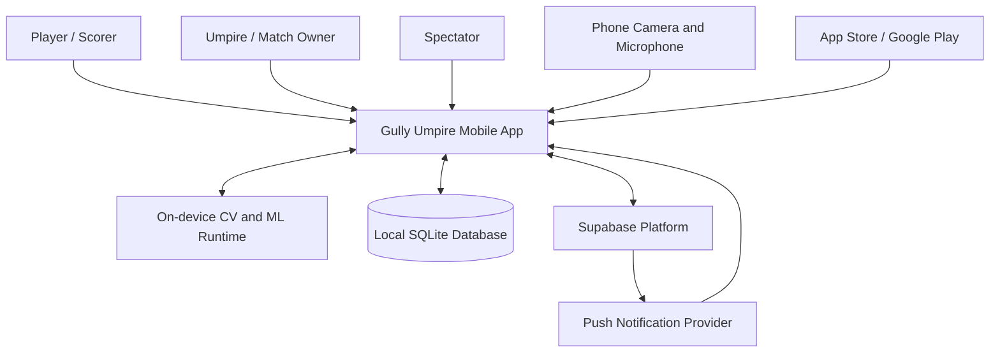

### Context responsibilities

| Actor/system | Responsibility |
|---|---|
| Player | Participates in match; may view scorecards, clips, and statistics |
| Umpire / scorer | Sets up match, calibrates wicket, reviews or overrides calls |
| Spectator | Receives live score and shared match information |
| Mobile app | Captures delivery, evaluates assistance rules, scores, syncs data |
| On-device CV runtime | Detects/tracks ball and batsman; provides confidence values |
| Supabase | Authentication, persistence, storage, realtime synchronization |

---

## 2. Use-case diagram

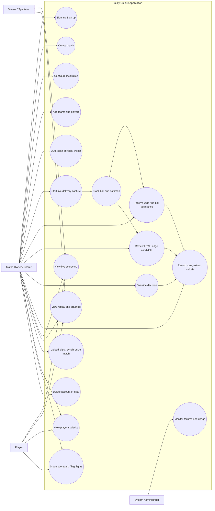

---

## 3. Component diagram

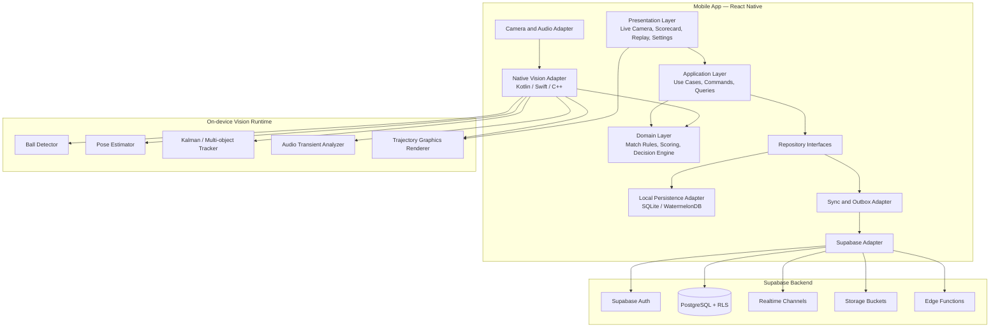

---

## 4. Mobile Clean Architecture diagram

```mermaid
flowchart TB
    subgraph Presentation[Presentation]
        Screens[Screens / Routes]
        ViewModels[View Models / Hooks]
        Widgets[Components / Overlays]
    end

    subgraph Application[Application]
        StartDelivery[Start Delivery Use Case]
        RecordDelivery[Record Delivery Use Case]
        SyncMatch[Sync Match Use Case]
        ReviewDecision[Review Decision Use Case]
        SetupMatch[Setup Match Use Case]
    end

    subgraph Domain[Domain]
        MatchAggregate[Match Aggregate]
        Scoring[Score Calculator]
        Rules[Wide / No-ball / LBW Rules]
        Decisions[Decision Engine]
        Trajectory[Trajectory Model]
        Events[Domain Events]
    end

    subgraph Ports[Ports / Interfaces]
        MatchRepo[Match Repository]
        DeliveryRepo[Delivery Repository]
        MediaRepo[Media Repository]
        VisionPort[Vision Service]
        Clock[Clock]
    end

    subgraph Infrastructure[Infrastructure]
        SQLite[SQLite Adapter]
        SupabaseAdapter[Supabase Adapter]
        Camera[Camera Adapter]
        ML[ML Runtime Adapter]
        StorageAdapter[Storage Adapter]
        Notification[Notification Adapter]
    end

    Screens --> ViewModels
    ViewModels --> Widgets
    ViewModels --> StartDelivery
    ViewModels --> RecordDelivery
    ViewModels --> ReviewDecision
    ViewModels --> SetupMatch

    StartDelivery --> VisionPort
    RecordDelivery --> MatchAggregate
    RecordDelivery --> DeliveryRepo
    ReviewDecision --> Decisions
    SyncMatch --> MatchRepo

    MatchAggregate --> Scoring
    MatchAggregate --> Rules
    Decisions --> Trajectory
    MatchAggregate --> Events

    MatchRepo --> SQLite
    MatchRepo --> SupabaseAdapter
    DeliveryRepo --> SQLite
    DeliveryRepo --> SupabaseAdapter
    MediaRepo --> StorageAdapter
    VisionPort --> Camera
    VisionPort --> ML
    Notification --> SupabaseAdapter
```

---

## 5. Computer-vision pipeline activity diagram

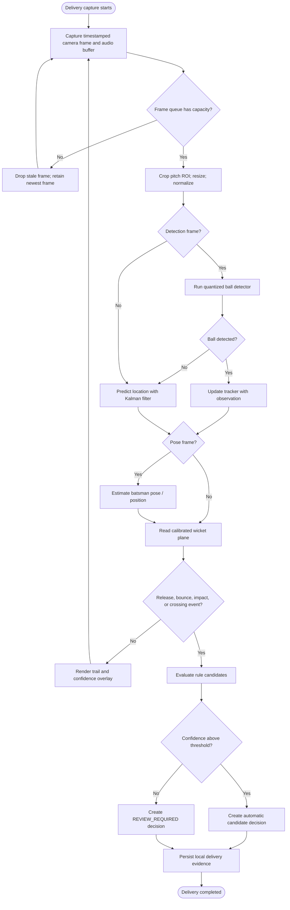

---

## 6. Live delivery sequence diagram

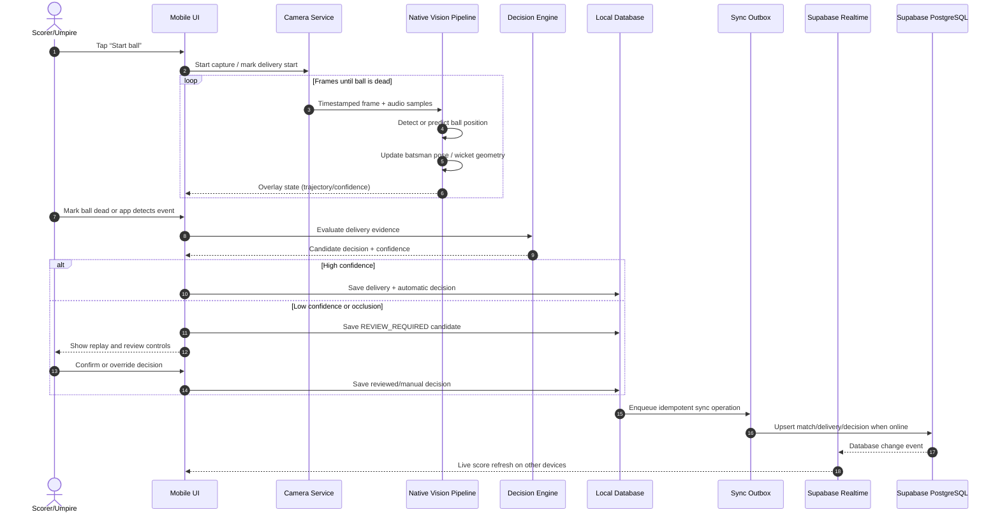

---

## 7. Offline synchronization sequence diagram

```mermaid
sequenceDiagram
    autonumber
    participant UI as Mobile UI
    participant Local as SQLite Database
    participant Outbox as Outbox Queue
    participant Network as Connectivity Monitor
    participant API as Supabase API
    participant DB as PostgreSQL

    UI->>Local: Commit delivery transaction
    Local->>Outbox: Add operation with client_operation_id
    Outbox-->>UI: Local operation complete

    Network-->>Outbox: Offline
    Note over Outbox: Retain queued operation; retry later

    Network-->>Outbox: Connection restored
    Outbox->>API: Send idempotent upsert(operation ID)
    API->>DB: Apply transaction + RLS validation
    DB-->>API: Success / conflict response

    alt Success
        API-->>Outbox: Acknowledgement
        Outbox->>Local: Mark operation synced
    else Transient failure
        API-->>Outbox: Retryable error
        Outbox->>Outbox: Backoff and retry
    else Conflict
        API-->>Outbox: Conflict details
        Outbox->>Local: Mark needs-resolution
        Local-->>UI: Show scorer resolution UI
    end
```

---

## 8. Match lifecycle state diagram

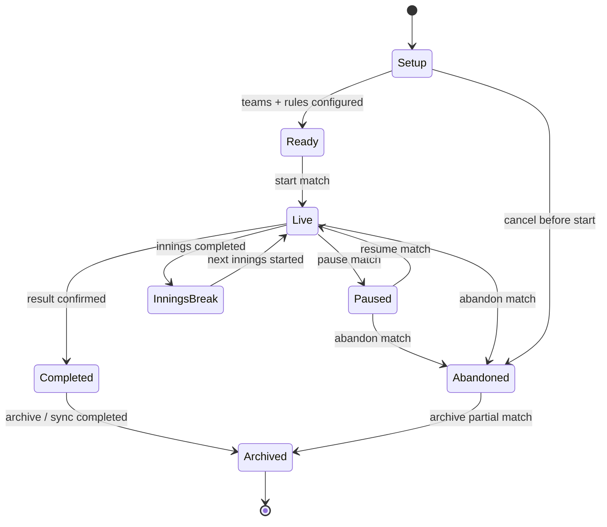

---

## 9. Delivery decision state diagram

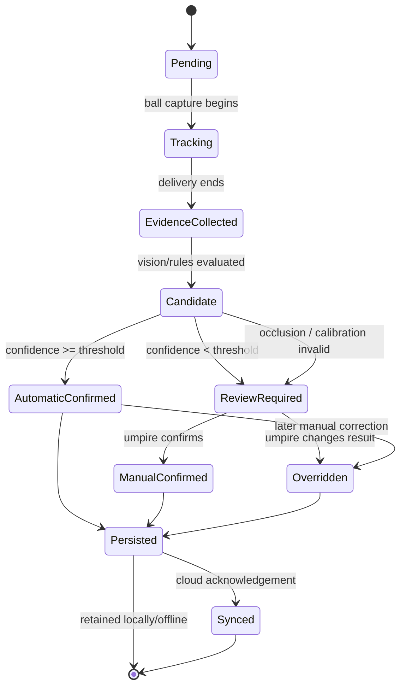

---

## 10. Database entity-relationship diagram

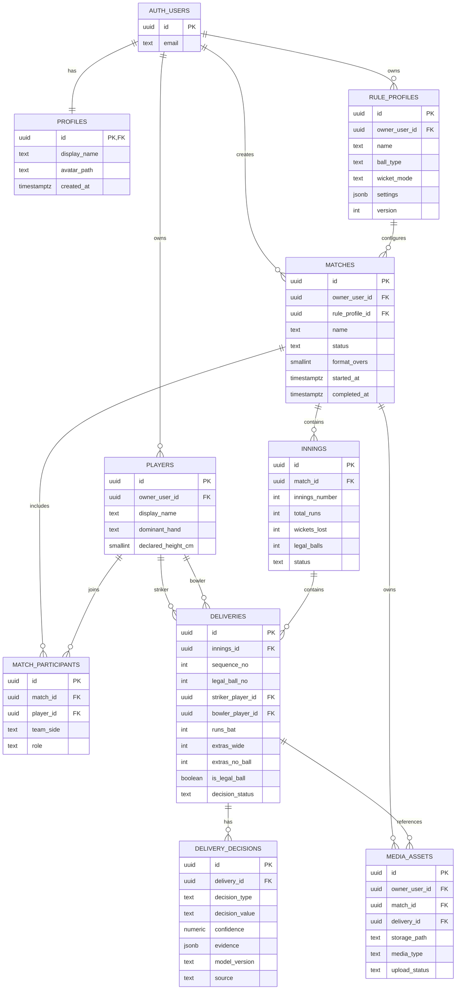

---

## 11. Class diagram: match and scoring domain

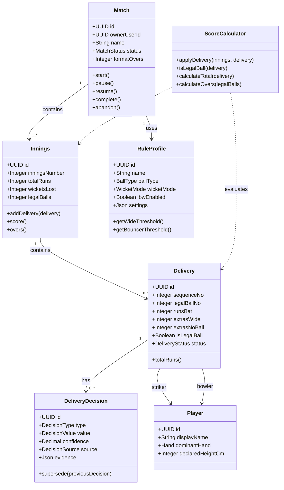

---

## 12. Class diagram: umpiring and vision domain

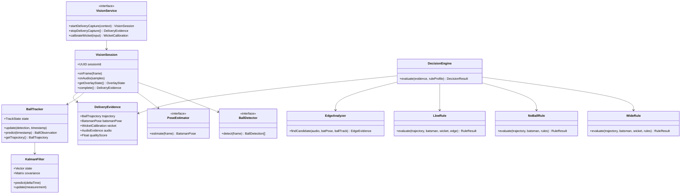

---

## 13. Class diagram: repositories and adapters

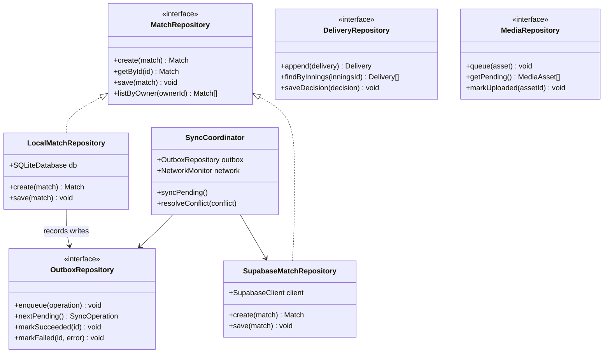

---

## 14. Deployment diagram

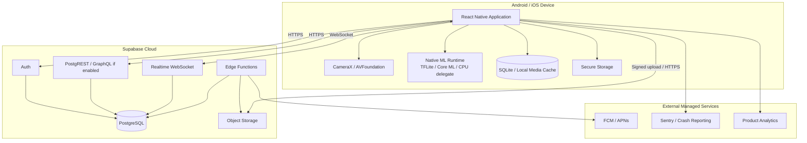

---

## 15. Wicket and camera calibration activity diagram

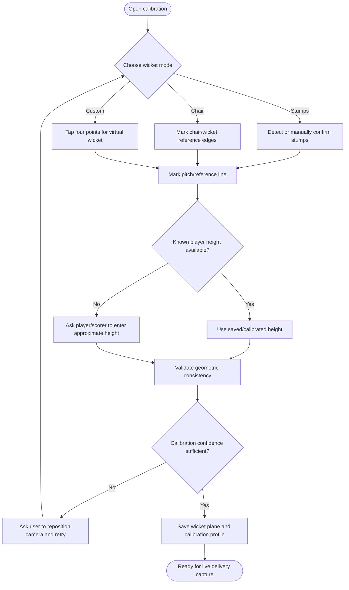

---

## 16. LBW and edge review sequence diagram

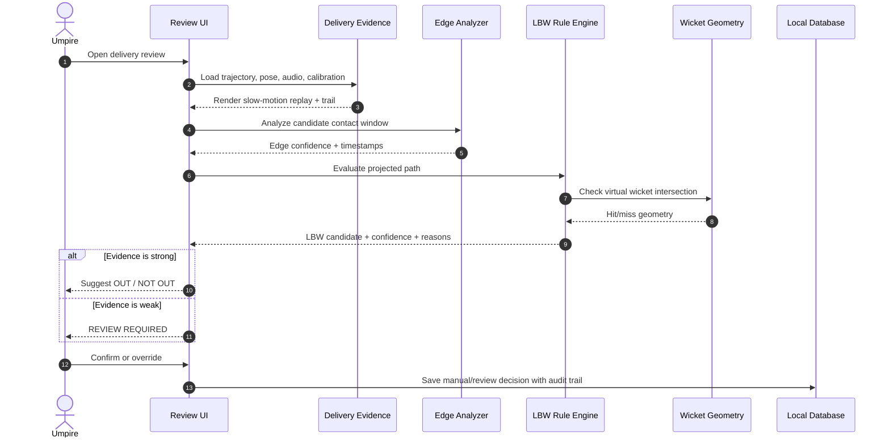

---

## 17. Event-driven integration diagram

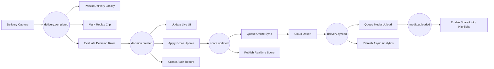

---

## 18. Authentication sequence diagram

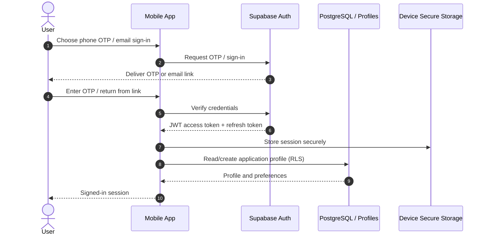

---

## 19. Media upload state diagram

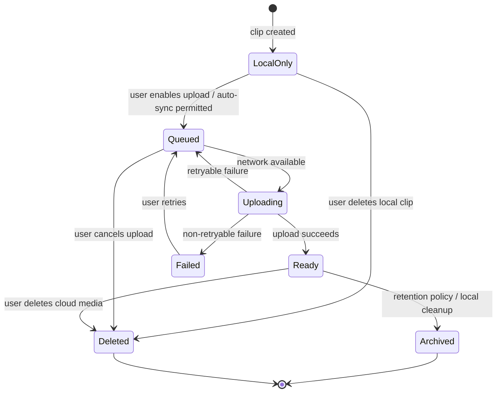

---

## Recommended diagram usage

| Diagram | Primary audience | Purpose |
|---|---|---|
| System context | Founder, product, stakeholders | Explains the product boundary and external systems |
| Use cases | Product, UX, QA | Defines supported user outcomes |
| Components | Technical leads | Shows major software modules and integrations |
| Clean Architecture | Mobile developers | Defines dependency and implementation boundaries |
| Vision activity | CV/ML and native developers | Defines real-time inference flow |
| Sequences | Mobile/backend developers | Defines interaction timing and ownership |
| State diagrams | Developers, QA | Defines legal transitions and test cases |
| ERD | Backend developers | Defines database relationships |
| Deployment | DevOps, security | Defines runtime topology and trust boundaries |

## Notes for implementation

- Treat Mermaid diagrams as living architecture artifacts. Update them with every meaningful change to modules, tables, event names, or deployment boundaries.
- Live decisions must remain on-device; network latency or cloud availability must never block a ball result.
- A `REVIEW_REQUIRED` state is mandatory for responsible behavior when visual/audio confidence is inadequate.
- Wicket calibration should be an explicit user flow because informal cricket wickets can be stumps, chairs, bricks, or a virtual target.
- Keep event names versioned and stable once other modules or clients depend on them.
